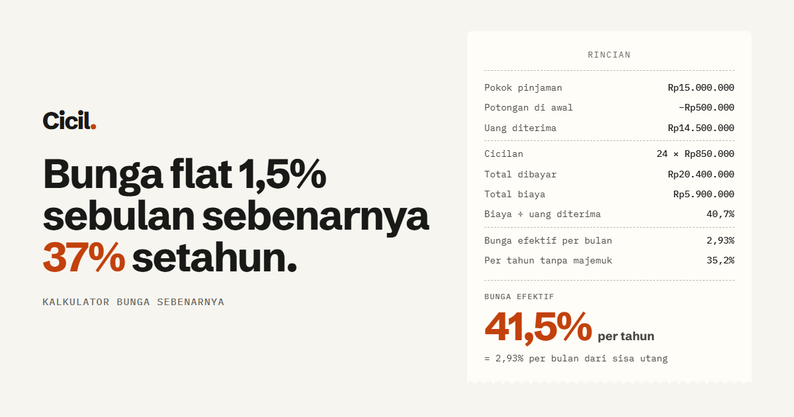

# Cicil



**[Buka Cicil](https://cicil-id.vercel.app)**

Kalkulator bunga sebenarnya. Masukkan uang yang kamu terima dan yang harus kamu bayar, lalu Cicil
menghitung bunga efektifnya: tingkat bunga dari sisa utang yang bisa dibandingkan antarpinjaman.

- **Tiga cara memasukkan pinjaman**: cicilan tetap (harian, mingguan, atau bulanan), bunga flat
  per bulan, dan pinjaman harian yang dilunasi sekali.
- **Potongan di awal** (biaya admin, provisi, asuransi) dihitung sebagai biaya, karena kamu
  mencicil pokok penuh padahal uang yang cair lebih sedikit.
- **Struk rincian**: total dibayar, total biaya, bunga efektif per periode, per bulan, dan per
  tahun, dengan dan tanpa pemajemukan.
- **Pokok dan bunga per cicilan**, dari bunga efektif, plus tabel cicilan lengkap.
- **Flat vs efektif**: kenapa bunga flat 1,5% per bulan setara sekitar 37% setahun, dan tabel
  konversinya untuk tenor 6 sampai 36 bulan.
- **Pinjaman harian**: biaya per hari cara OJK menghitung, dibandingkan dengan batas manfaat
  ekonomi pinjaman daring konsumtif.

Contoh di halaman (kredit barang, paylater, cicilan mingguan, pinjaman 30 hari) adalah angka
ilustrasi, bukan produk tertentu. Isian tersimpan di alamat halaman, jadi hasilnya bisa dibagikan.

## Cara hitung

Bunga efektif per periode adalah tingkat bunga yang membuat uang yang diterima sama dengan nilai
sekarang semua pembayaran (IRR), dicari dengan biseksi; hasilnya sama dengan fungsi `RATE` di
spreadsheet. Per tahun dimajemukkan: (1 + bunga per periode)^periode setahun − 1. Semua hitungan
ada di `src/hitung.ts` dan diuji di `src/hitung.test.ts`.

Batas OJK yang dipakai untuk pembanding: 0,3% per hari untuk tenor di bawah 6 bulan dan 0,2% per hari
untuk 6 bulan ke atas, menurut
[siaran pers OJK](https://ojk.go.id/id/berita-dan-kegiatan/siaran-pers/Pages/LPBBTI-dan-BNPL.aspx)
yang berlaku sejak 1 Januari 2025 (Surat Edaran OJK Nomor 19 Tahun 2023). Batasnya bisa berubah;
periksa ojk.go.id.

Semua berjalan di peramban. Ini alat bantu hitung, bukan nasihat keuangan.

## Menjalankan

```
npm install
npm run dev
npm test
npm run build
```
